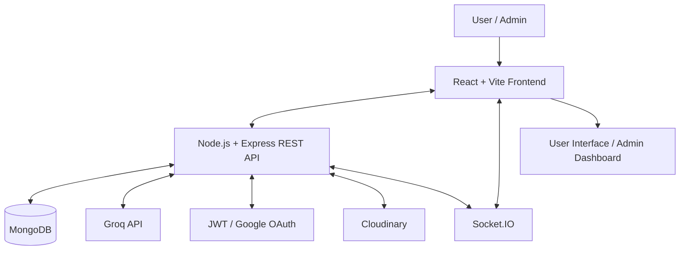

# ✈️ TripPilot-AI

### AI-Powered Travel Planning Platform

\<p align="center">
&#x20; \<strong>Discover destinations. Plan smarter trips. Explore India with AI.\</strong>
\</p>

\<p align="center">
&#x20; \<a href="[https://trip-pilot-ai-liart.vercel.app](https://trip-pilot-ai-liart.vercel.app)">🌐 Live Demo\</a> ·
&#x20; \<a href="[https://github.com/sundar067/TripPilot-AI](https://github.com/sundar067/TripPilot-AI)">💻 Source Code\</a> ·
&#x20; \<a href="[https://trippilot-ai-ra36.onrender.com](https://trippilot-ai-ra36.onrender.com)">⚙️ Backend API\</a>
\</p>

\<p align="center">
&#x20; \
&#x20; \
&#x20; \
&#x20; \
&#x20; \
&#x20; \
\</p>

---

## 🌍 About the Project

**TripPilot-AI** is a full-stack travel planning platform that brings destination discovery, trip organization, personalized travel assistance, and travel management together in one place.

Built using the **MERN stack**, the platform helps users explore Indian states and tourist destinations, discover attractions, create trip plans, save favorite places, and get AI-assisted travel guidance through an integrated chatbot.

The application also features a dedicated **Admin Dashboard** for managing users, states, destinations, attractions, and platform analytics.

With a responsive interface, Google authentication, and real-time communication, TripPilot-AI aims to make discovering places and organizing journeys simpler and more convenient.

## ✨ Features

### 🏞️ Explore India

- Browse Indian states and tourist destinations.
- Explore state-wise destinations and detailed destination pages.
- Discover attractions and view destination imagery.
- Navigate between states, destinations, and related places.

### 🔎 Search & Discover

- Search for destinations.
- Filter and explore available places.
- View detailed information about selected destinations.
- Discover travel options through an organized interface.

### 🤖 AI Travel Assistant

- Interact with an AI-powered travel chatbot.
- Ask travel-related questions in a conversational format.
- Get AI-assisted destination ideas and travel guidance.
- Powered by the configured Groq API integration.

### 🧳 Trip Planning

- Create and manage personal trip plans.
- View trip details and saved travel information.
- Keep travel plans organized in one place.

### ❤️ Wishlist

- Save favorite destinations.
- View and manage saved places.
- Keep a personal collection of destinations for future trips.

### 📍 Nearby Attractions

- Discover supported nearby places and attractions.
- Explore attraction details.
- Find additional places of interest while planning a journey.

### 👤 Authentication & User Profiles

- User registration and login.
- Google sign-in using OAuth.
- Profile management and account settings.
- Protected routes for authenticated features.

### 🔔 Real-Time Notifications

- Receive supported application notifications.
- Real-time communication using Socket.IO.
- Separate user and administrative notification audiences according to the application's notification logic.

### 🛡️ Admin Dashboard

- Dashboard analytics and insights.
- User management.
- State management.
- Destination management.
- Attraction management.
- Administrative actions and account settings.

---

## 🖥️ Application Architecture

TripPilot-AI follows a client-server architecture in which the React frontend communicates with the Express backend, while MongoDB stores application data.



### How It Works

1. Users interact with the React frontend.
2. Frontend services send requests to the backend API.
3. Express routes and controllers process application requests.
4. Mongoose manages communication with MongoDB.
5. The backend integrates configured external services when required.
6. The frontend displays the resulting information.
7. Socket.IO supports configured real-time events.

---

## 🧰 Tech Stack

| Technology                 | Purpose                                |
| -------------------------- | -------------------------------------- |
| React.js                   | Frontend user interface                |
| Vite                       | Frontend development and build tooling |
| Tailwind CSS               | Responsive styling                     |
| Node.js                    | Backend runtime                        |
| Express.js                 | REST API and server-side logic         |
| MongoDB                    | Database                               |
| Mongoose                   | Database models and operations         |
| Groq API                   | AI chatbot integration                 |
| JWT                        | Authentication                         |
| Google OAuth / Passport.js | Google sign-in                         |
| Socket.IO                  | Real-time communication                |
| Cloudinary                 | Media management                       |
| Axios                      | HTTP requests                          |
| React Router               | Frontend navigation                    |
| Git & GitHub               | Version control                        |
| Vercel                     | Frontend deployment                    |
| Render                     | Backend deployment                     |

---

## 📂 Project Structure

```text
TripPilot-AI/
│
├── client/                         # React frontend
│   ├── public/                     # Public assets
│   └── src/
│       ├── assets/                 # Images and other assets
│       ├── components/
│       │   ├── admin/              # Admin dashboard components
│       │   ├── attraction/         # Attraction components
│       │   ├── common/             # Shared UI components
│       │   ├── destination/        # Destination components
│       │   ├── filter/             # Filtering components
│       │   ├── search/             # Search components
│       │   ├── state/              # State components
│       │   └── trip/               # Trip planning components
│       ├── lib/                    # Shared libraries
│       ├── pages/                  # Application pages
│       │   └── admin/              # Admin pages
│       ├── routes/                 # Route protection
│       ├── services/               # API service modules
│       ├── App.jsx
│       └── main.jsx
│
├── server/                         # Node.js backend
│   ├── config/                     # Service configuration
│   ├── controllers/                # Request handlers
│   ├── data/                       # Application data
│   ├── middleware/                 # Auth and upload middleware
│   ├── migrations/                 # Database maintenance scripts
│   ├── models/                     # Mongoose models
│   ├── routes/                     # API routes
│   ├── seed/                       # Seed scripts
│   ├── utils/                      # Shared utilities
│   ├── index.js                    # Backend entry point
│   └── package.json
│
├── .gitignore
└── README.md
```

*This is a simplified overview; some files and subdirectories are omitted.*

---

## ⚙️ Getting Started

Follow these steps to run TripPilot-AI locally.

### Prerequisites

- [Node.js and npm](https://nodejs.org/)
- [Git](https://git-scm.com/)
- [MongoDB Atlas](https://www.mongodb.com/atlas) or a compatible MongoDB instance
- Groq API credentials for the AI chatbot
- Google OAuth credentials for Google sign-in
- Cloudinary credentials if required by the configured media features

### 1. Clone the Repository

```bash
git clone https://github.com/sundar067/TripPilot-AI.git
cd TripPilot-AI
```

### 2. Install Backend Dependencies

```bash
cd server
npm install
```

### 3. Install Frontend Dependencies

Open a second terminal from the project root:

```bash
cd client
npm install
```

### 4. Configure Environment Variables

Create the environment files described below and add your own credentials. The variable names must match those used by your application.

**Backend — `server/.env`**

```env
PORT=5000
MONGO_URI=your_mongodb_connection_string
GROQ_API_KEY=your_groq_api_key

CLIENT_URL=http://localhost:5173

GOOGLE_CLIENT_ID=your_google_client_id
GOOGLE_CLIENT_SECRET=your_google_client_secret
GOOGLE_CALLBACK_URL=http://localhost:5000/api/auth/google/callback

CLOUDINARY_CLOUD_NAME=your_cloudinary_cloud_name
CLOUDINARY_API_KEY=your_cloudinary_api_key
CLOUDINARY_API_SECRET=your_cloudinary_api_secret
```

**Frontend — `client/.env`**

```env
VITE_API_URL=http://localhost:5000/api
```

Only add variables that are required by the current application configuration. Never commit real API keys, passwords, OAuth secrets, or database credentials.

### 5. Start the Backend

In the backend terminal:

```bash
cd server
npm run dev
```

The backend should start on the configured port and connect to MongoDB.

### 6. Start the Frontend

In the frontend terminal:

```bash
cd client
npm run dev
```

Open the local URL displayed by Vite, usually:

`http://localhost:5173`

Keep both development servers running while using the application.

---

## 🚀 Live Deployment

| Component   | Platform | Link                                                         |
| ----------- | -------- | ------------------------------------------------------------ |
| Frontend    | Vercel   | [Open TripPilot-AI](https://trip-pilot-ai-liart.vercel.app)  |
| Backend     | Render   | [Backend Service](https://trippilot-ai-ra36.onrender.com)    |
| Source Code | GitHub   | [View Repository](https://github.com/sundar067/TripPilot-AI) |

### Production Configuration

Configure production environment variables through the hosting dashboards.

**Vercel — Frontend**

```env
VITE_API_URL=https://trippilot-ai-ra36.onrender.com/api
```

**Render — Backend**

```env
CLIENT_URL=https://trip-pilot-ai-liart.vercel.app
GOOGLE_CALLBACK_URL=https://trippilot-ai-ra36.onrender.com/api/auth/google/callback
```

Also configure the required MongoDB, Groq, Google OAuth, and Cloudinary credentials.

> **Note:** The Google OAuth callback URL must match the backend route and the authorized redirect URI in Google Cloud Console. Keep production credentials private.

---

## 🔐 Security

- Keep `.env` files out of version control.
- Store secrets in environment variables.
- Protect private API endpoints with authentication middleware.
- Restrict administrative actions to authorized administrators.
- Validate input on the backend.
- Configure CORS for the intended frontend origins.
- Avoid exposing sensitive user data, passwords, or access tokens.
- Use HTTPS in production.

---

## 🛣️ Future Scope

Potential enhancements for future versions include:

- AI-generated personalized itineraries.
- Travel budget estimation.
- Weather-aware travel suggestions.
- Interactive maps and route planning.
- Collaborative trip planning and sharing.
- More personalized destination recommendations.

---

## 👨‍💻 Author

**Sundar Singh**

B.Tech,Information Technology

- GitHub: [@sundar067](https://github.com/sundar067)
- Project: [TripPilot-AI](https://github.com/sundar067/TripPilot-AI)

---

\<p align="center">
&#x20; \<strong>✈️ TripPilot-AI\</strong>\<br/>
&#x20; \<em>Your Journey, Intelligently Planned.\</em>
\</p>
